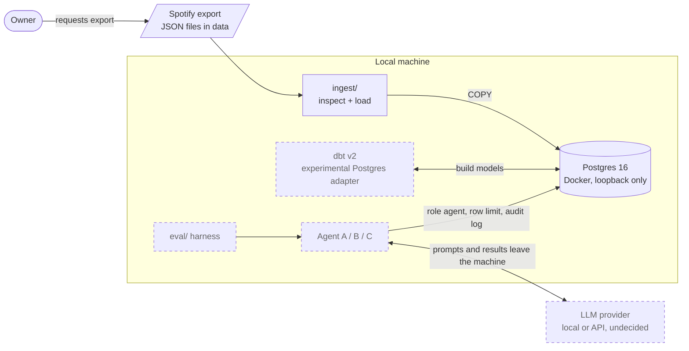
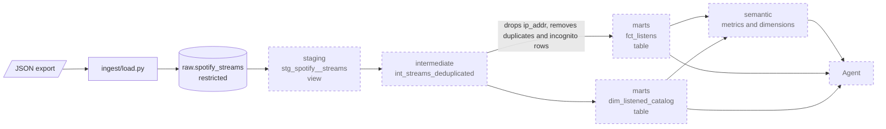
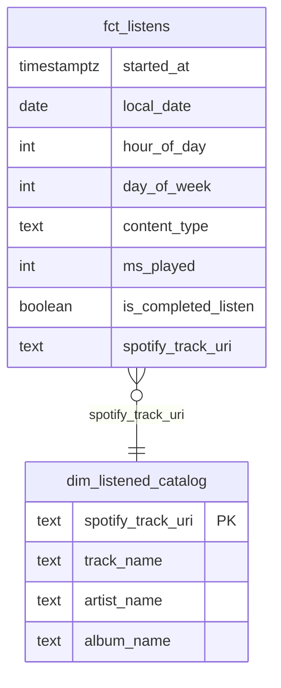
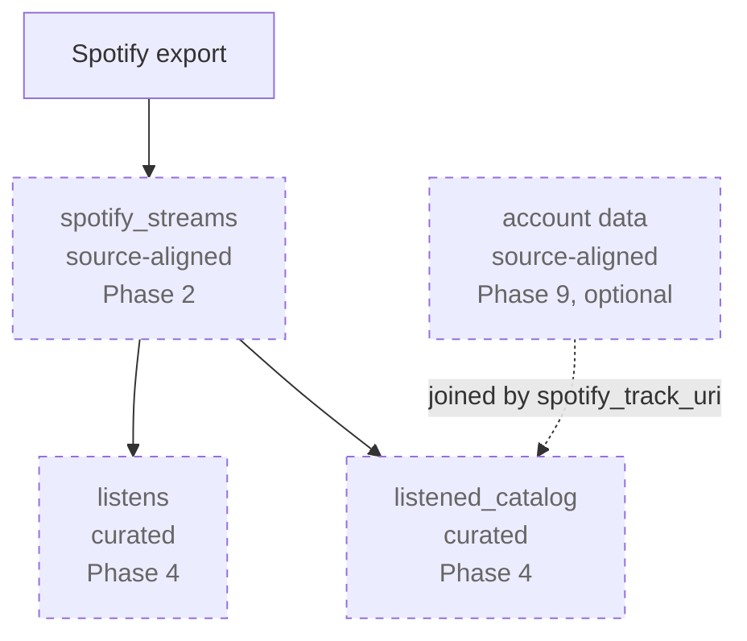
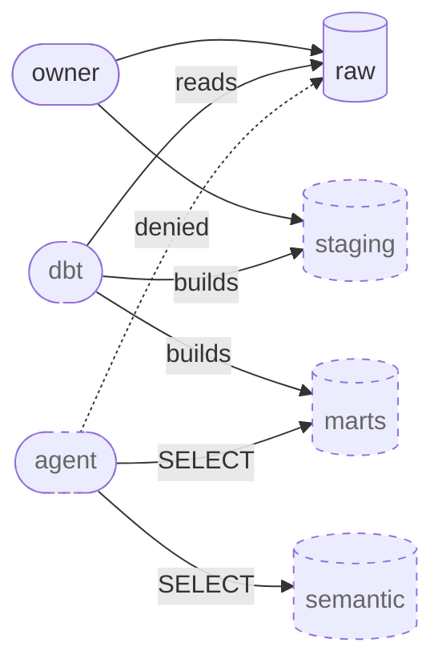
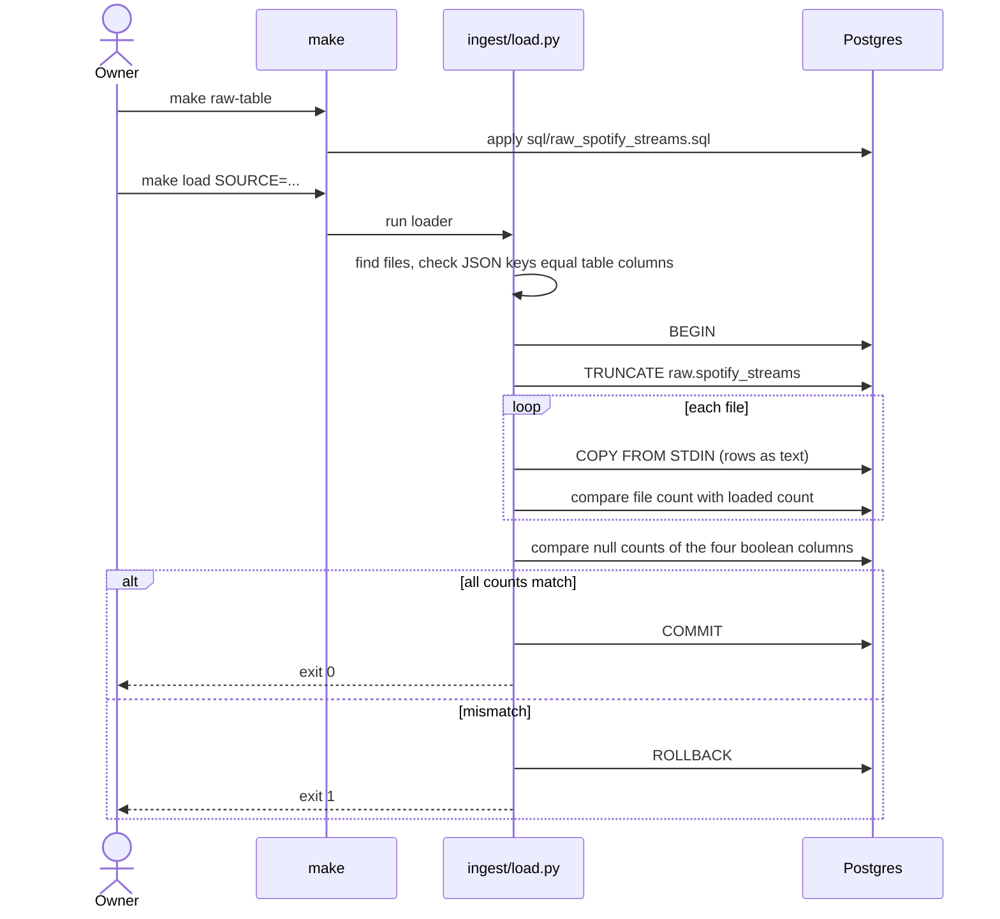
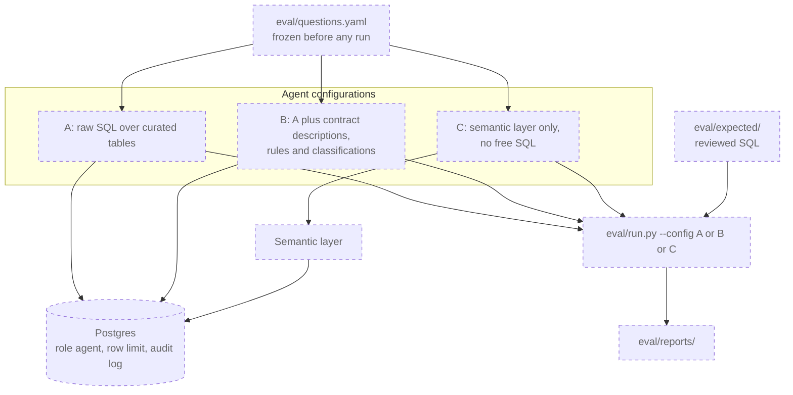

# Architecture

How the project fits together: components, data flow, governance and the plan to evaluate an AI agent on top of it. Decisions are recorded as ADRs (see [README.md](README.md)); the phased plan is in [.claude/plans/implementation-plan.md](../.claude/plans/implementation-plan.md) and the business rules in [.claude/plans/business-rules.md](../.claude/plans/business-rules.md).

## Purpose

A personal data mesh over the Spotify extended streaming history export. Postgres, dbt v2, ODCS data contracts, a semantic layer and an AI agent, with an eval that compares three agent configurations.

Hypothesis: data contracts and a semantic layer make the agent err less than raw SQL over tables (configuration A < B < C).

## Status

Only part of the design exists. Diagrams use solid boxes for what is implemented and dashed boxes for what is planned.

| Phase | Content | Status |
| --- | --- | --- |
| 0 | Foundation: Docker, Postgres, uv, sample data | Done |
| 1 | Raw ingestion into `raw.spotify_streams` | Done |
| 2 | Roles, schemas, grants, first contract | Planned |
| 3 | dbt staging, deduplication, `fct_listens` | Planned |
| 4 | Catalog product, contracts as code, privacy CI | Planned |
| 5 | Eval harness, configuration A | Planned |
| 6 | Configuration B, larger eval | Planned |
| 7 | Semantic layer, configuration C | Planned |
| 8 | Final eval and report | Planned |
| 9 | Optional: account data, article | Planned |

## System context

Everything runs on one machine. The only data that leaves it is what the agent reads and sends to the LLM provider, which is why the agent role is restricted and every query is logged.



## Components

| Component | Role | Status |
| --- | --- | --- |
| Postgres 16 | Warehouse. Docker service `db`, bound to `127.0.0.1` only, data in volume `pgdata`. | Implemented |
| Python 3.12 and uv | Ingestion scripts, sample generator, tests. Dependencies pinned in `pyproject.toml` and `uv.lock`. | Implemented |
| Make | Single entry point: `up`, `down`, `reset`, `psql`, `sample`, `test`, `raw-table`, `load`, `inspect`. There is no orchestrator. | Implemented |
| dbt v2 (`dbt-oss`) | Transformations, tests, documentation. Postgres adapter is experimental, see [ADR 0001](0001-dbt-v2-experimental-postgres.md). Run it as `bin/dbt`. | Planned, Phase 3 |
| ODCS contracts | One YAML contract per data product, checked with the Data Contract CLI. | Planned, Phases 2 and 4 |
| Semantic layer | Governed metrics and dimensions. MetricFlow or Cube, decided in Phase 7. | Planned |
| Agent | Three configurations over the same model and base prompt. | Planned, Phases 5 to 7 |
| Eval harness | Frozen questions, reviewed expected SQL, reports. | Planned, Phases 5 to 8 |

## Data flow

Data moves in one direction. The intermediate model is the only step that drops restricted fields, so everything after it is safe to expose.



### Layers

| Layer | Schema | Content | Materialization | Status |
| --- | --- | --- | --- | --- |
| Raw | `raw` | One row per export record, unchanged, plus `source_file` and `loaded_at`. | Table, replaced on each load | Implemented |
| Staging | `staging` | Rename and cast. Start time is `ts - ms_played`. Units of `offline_timestamp` are interpreted here. | View | Planned |
| Intermediate | Decided in Phase 3 | Drops `ip_addr`, removes exact duplicates, excludes incognito rows. | View | Planned |
| Marts | `marts` | `fct_listens` (`local_date`, `hour_of_day`, `day_of_week` in Europe/Lisbon, `content_type`, `is_completed_listen`) and `dim_listened_catalog` keyed by `spotify_track_uri`. | Table | Planned |
| Semantic | `semantic` | Metrics: `hours_listened`, `completed_listens`, `skip_rate`, `distinct_artists`, `listens`. | n/a | Planned |

Model naming follows dbt conventions: `stg_<source>__<entity>`, `fct_`, `dim_`, one `_<folder>__models.yml` per folder. The planned folder layout is in the implementation plan.

### Mart model



The column lists are illustrative. The exact columns are decided in Phases 3 and 4.

## Data products and contracts

Each product has one ODCS contract in `contracts/`, with a classification on every property.



| Classification | Fields | Rule |
| --- | --- | --- |
| Restricted | `ip_addr` | Kept in raw, removed before marts, never readable by the agent. |
| Confidential | `conn_country` | Allowed in curated products, handled with care. |
| Internal | All others | No special handling. |

The plan does not include dbt model versions, `access` levels or enforced dbt contracts. Contracts here are ODCS documents, used for governance and, in configuration B, as agent context.

## Security and privacy

The rule (constitution, principle I, non-negotiable): restricted fields must not reach curated products, the semantic layer, the agent or the eval. It is enforced by database permissions, not by prompts.



| Control | Detail | Status |
| --- | --- | --- |
| Roles | `owner` (sees raw), `dbt` (builds), `agent` (reads curated and semantic schemas only). Grants in `sql/roles.sql`. Today only `owner` exists. | Planned, Phase 2 |
| Row limit and audit log | Every agent query is limited and logged locally (question, generated query, row count). | Planned |
| Privacy CI | A test fails if any restricted field appears in a mart. | Planned, Phase 4 |
| Incognito policy | Rows with `incognito_mode = true` are excluded from curated products by default. | Planned, Phase 3 |
| Git hygiene | `data/` and `.env` are git-ignored. `tests/test_repo_hygiene.py` fails if a tracked or untracked text file contains an IP address outside the documentation ranges. | Implemented |
| Safe output | The loader and inspector print counts, never values. Database errors are filtered so values are not echoed. | Implemented |
| Network | Postgres listens on loopback only. | Implemented |
| LLM boundary | Whatever the agent reads goes to the LLM provider. | Planned |

The repository is public, so only code, contracts, eval questions, synthetic sample data and structure-only findings are committed.

## Ingestion

The raw table keeps the export as it arrives (load first, transform later).



| Item | Detail |
| --- | --- |
| Inspection | `make inspect SOURCE=data` prints structure, counts and types without values and without a database. |
| Table definition | [sql/raw_spotify_streams.sql](../sql/raw_spotify_streams.sql). The loader never creates or alters the table. |
| Loading | Rows are streamed with `COPY`, one file at a time. Nothing is written to disk. A load replaces the table content. |
| Exit codes | 0 ok, 1 counts differ, 2 bad input or configuration, 3 database error. |
| Sample data | `make sample` writes a deterministic synthetic dataset with the same schema and the known edge cases. The whole pipeline must run on it without the real export. |

Facts about the export that shape later layers (details in [real-export-findings.md](real-export-findings.md)):

- Content type does not follow the file name. Podcast episodes appear in Audio files and music appears in a Video file, so `content_type` is derived from which field group is filled.
- `offline_timestamp` mixes seconds and milliseconds.
- `ip_addr` holds both IPv4 and IPv6 addresses.
- The export contains exact duplicate records and nullable booleans.

## Agent and eval

All configurations use the same model and base prompt, run as the `agent` role, and are scored by the same harness against reviewed expected SQL.



| Aspect | Detail |
| --- | --- |
| Questions | 12 in Phase 5, about 25 in Phase 6, 40 or more in Phase 8. |
| Measures | Numeric accuracy, definition adherence, correct refusal, tokens, latency. |
| Limitation | One user's data only. The final report must say so. |

## Open decisions

| Decision | Default | Decided in |
| --- | --- | --- |
| Completed listen threshold | `ms_played >= 30s` | Phase 3 |
| Podcasts in `hours_listened` | Yes, split by `content_type` | Phase 3 |
| Incognito rows | Excluded from curated | Phase 3 or 4 |
| Audiobook as a third `content_type` | Open (no audiobook records in the current export) | Phase 3 |
| MetricFlow or Cube | MetricFlow first | Phase 7 |
| Local or API LLM | Open | Phase 6 |

## Repository map

```text
spotify-data-mesh/
  data/             real export, git-ignored (only data/README.md is tracked)
  sample_data/      synthetic generator and committed sample files
  ingest/           inspect_export.py, load.py
  sql/              raw_spotify_streams.sql (roles.sql comes in Phase 2)
  tests/            generator, inspector, loader and repo hygiene tests
  docs/             ADRs, findings, this document
  specs/            Spec Kit artifacts per phase (001, 002)
  contracts/        empty until Phase 2
  dbt/              empty until Phase 3
  agent/            empty until Phase 5
  eval/             empty until Phase 5
  .claude/plans/    implementation plan and business rules
  .specify/         Spec Kit scaffolding and the project constitution
```
